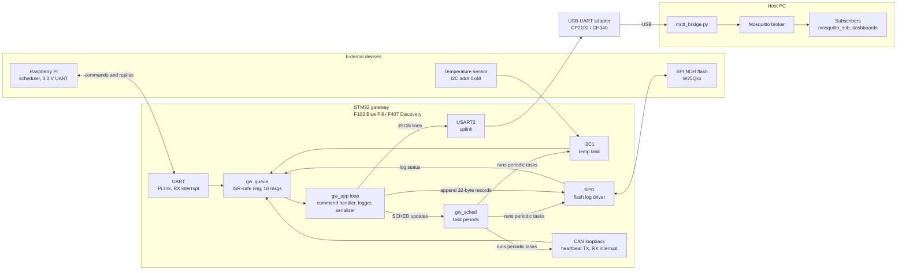
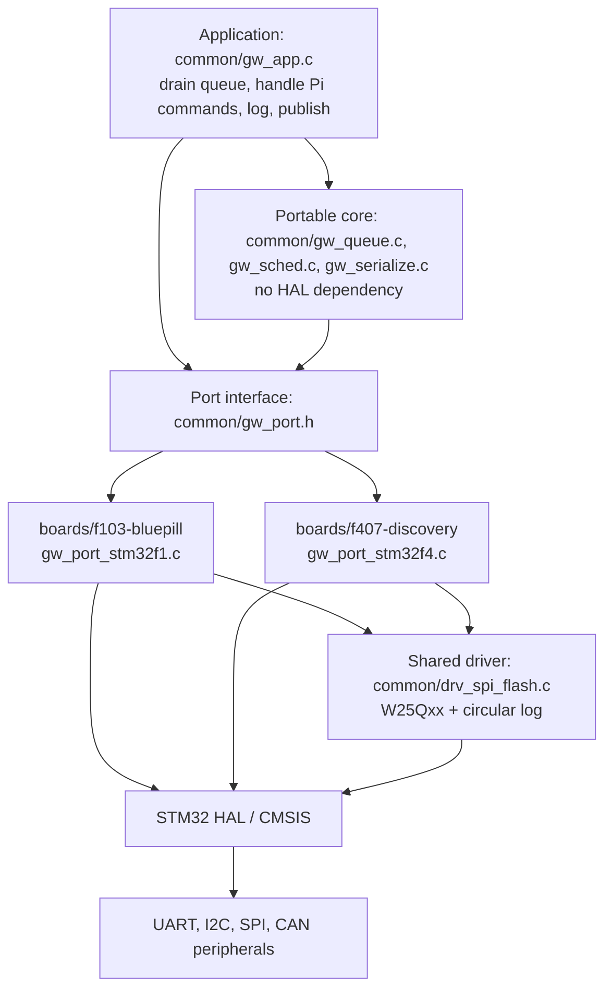

# STM32 Multi-Protocol IoT Gateway (Prototype)

A gateway prototype that integrates **UART, I²C, SPI and CAN** field interfaces with an
**MQTT telemetry layer**. It was built on an **STM32F103C8T6 "Blue Pill" (ARM Cortex-M3)**,
with a port to the **STM32F407 Discovery (ARM Cortex-M4)** in progress.

- **UART:** a Raspberry Pi (3.3 V link) acts as the scheduler, changing how often each gateway task runs
- **I²C:** temperature sensor (LM75 / TMP102 compatible)
- **SPI:** external NOR flash used as a circular telemetry log ("black box")
- **CAN:** loopback mode, so the full CAN TX/RX path is exercised with a single board
- **MQTT:** JSON telemetry over a USB-UART adapter to a PC bridge that publishes to Mosquitto

The firmware is split into a **hardware-independent core** (`common/`) shared by every board,
and a thin **board-specific port layer** (`boards/<board>/`) written against the STM32 HAL.

## System architecture



### Firmware layers



### Scheduling command from the Raspberry Pi

```mermaid
sequenceDiagram
    participant P as Raspberry Pi
    participant ISR as UART RX ISR
    participant A as gw_app loop
    participant S as gw_sched
    participant F as SPI flash
    participant M as PC bridge and MQTT
    P->>ISR: SCHED temp 2000
    ISR->>A: line queued as gw_msg_t
    A->>S: gw_sched_command
    S-->>A: OK temp 2000
    A->>P: OK temp 2000
    A->>F: append log record
